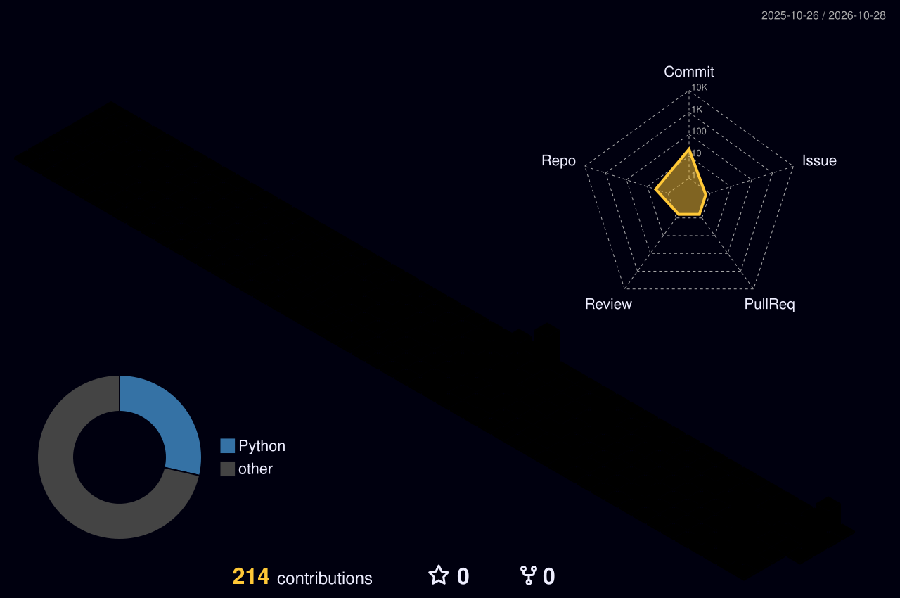

# Olá, eu sou o Albeson 👋

Desenvolvedor de software, do backend em C# e nuvem até sistemas embarcados em Linux.

## No que estou trabalhando

- 🚁 **fpvcast**: um receptor de vídeo FPV em C para Raspberry Pi. O Pi se passa por um celular Android, recebe o
  H.264 dos óculos DJI pela USB e mostra no HDMI com decodificação na GPU, com cerca de 27 ms de latência no
  decodificador. Inclui interface web de configuração, ponto de acesso Wi-Fi de emergência e imagem pronta para
  gravar no cartão.
- 📚 Estudando streaming de vídeo de baixa latência (RTMP, WebRTC) e mais sobre Linux embarcado.

## Com o que eu trabalho

**Aplicações e nuvem**

**Bancos de dados**

**Sistemas e embarcados**

**Ferramentas**

## Fale comigo

- 💬 Pergunte-me sobre: C#, Node.js, nuvem, Linux embarcado, USB e vídeo H.264.

## Contribuições

  

